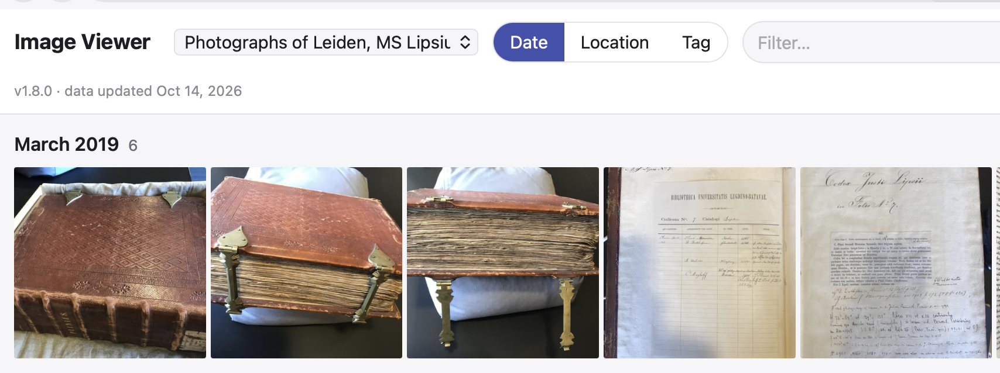
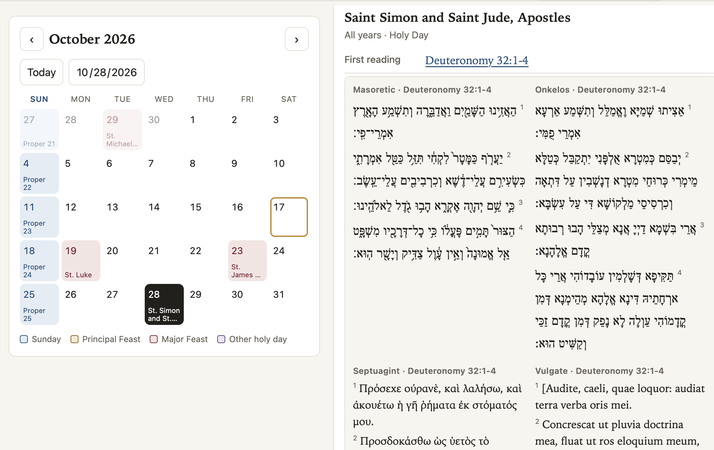

## Hobby apps

Agentic coding with Claude is amazing. That's not news: I seem to run across multiple stories every day about businesses or entire industries that are being turned upside down by agentic coding.  (Have you [downloaded artcraft](https://getartcraft.com/download) yet?)

But agentic coding is a game changer for hobby projects, too. One category of small projects I've played with this week revolve around replacing an existing professional app with a Claude-coded app that lets me add my own annotations to data. I don't want a complex application or cloud-managed "solution" to browse media files like images and audio files in my local file system. In addition to the basic functionality I actually use in those kinds of apps (panning and zooming images, playing audio tracks), I want to annotate images or audio data in simple delimited-text files. Like an [image viewer](https://github.com/neelsmith/imageviewer) that lets me view image files and pulls in cataloging data if I've dropped a delimited-text file in the file tree, but displays the image without complaining if it's not documented. Or an [audio player](https://github.com/neelsmith/audioplayer) that works similarly. The first one took Claude and me a good part of a morning, as I felt my way through the set up and definitions for the project. The second one was what I call "a breakfast project": a project that I start with my first cup of coffee, and (thanks to Claude) has reached a releasable version before I finish my second cup.

Or how about specialized readers? A number of web sites support reading texts following the calendar of the Revised Common Lectionary, but I'd like to automate bringing in my own content. That was a [breakfast project](https://github.com/neelsmith/rcl). 

Or what if you wanted to do something similar with the weekly parshah and haftarah readings in the Hebrew calendar? That was [this morning's breakfast project](https://github.com/neelsmith/parshah).

## Personalizing content simply

Each of these apps is implemented in a single, self-contained HTML file that can be hosted on a web server or opened in a web browser from a local copy. The simplicity of a single file in the universal platform of the web browser is appealing, but their real motivation was to personalize the data they work with. Plain-text files with your choice of data keyed to unique identifiers (perhaps file name for an audio file, or a CTS URN for a passage of text) suffice. If you've used [Obsidian](https://obsidian.md), you already appreciate the power of an app that lets you work with plain text in simple formats. A breakfast with Claude is enough to fold image browsing, audio playback or complicated calendrical lookups into the mix.

::: {.callout-note}
I've added a [page to this site](https://neelsmith.github.io/avocational/code/) with links to these and any further hobby projects I add.
:::

